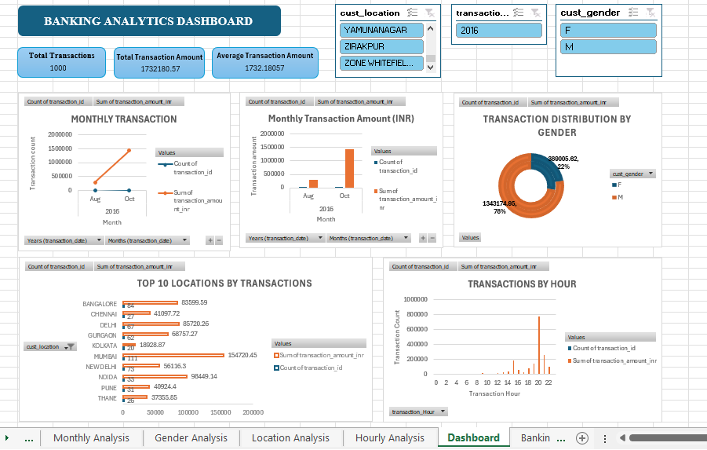

🏦 Banking Analytics Dashboard Using Microsoft Excel

📌 Project Overview

This project focuses on analysing banking transaction data and presenting meaningful insights through an interactive dashboard developed using Microsoft Excel.

The dashboard provides a clear overview of banking transactions, transaction amounts, and key financial metrics to support data-driven decision-making.

The main objective of this project is to transform raw banking data into meaningful visual insights that help understand transaction patterns and financial performance.

🎯 Project Objectives

- Analyse banking transaction data.
- Identify important transaction trends and patterns.
- Calculate key performance indicators (KPIs).
- Understand transaction amounts and distribution.
- Present insights through interactive visualisations.
- Support better business decision-making using data.

🛠️ Tools & Technologies Used

- Microsoft Excel
- Excel Formulas
- Pivot Tables
- Pivot Charts
- Data Cleaning
- Data Analysis
- Data Visualization
- Interactive Dashboard Design

📊 Key Performance Indicators (KPIs)

The dashboard includes the following key metrics:

- Total Transactions
- Total Transaction Amount
- Average Transaction Amount

📈 Dashboard Features

- Overall banking transaction overview.
- KPI cards for important financial metrics.
- Visual representation of transaction data.
- Interactive charts and visualisations.
- Easy-to-understand dashboard layout.
- Data-driven insights into banking transactions.

🧹 Data Cleaning & Preparation

Before creating the dashboard, the dataset was prepared for analysis.

The data preparation process included:

- Understanding the dataset structure.
- Checking missing values.
- Identifying duplicate records.
- Checking data consistency.
- Preparing the dataset for analysis.

💡 Key Learnings

Through this project, I gained practical experience in:

- Working with real-world structured datasets.
- Cleaning and preparing data using Excel.
- Creating KPIs using Excel formulas.
- Analysing data using Pivot Tables.
- Designing interactive dashboards.
- Presenting data through meaningful visualisations.

🖥️ Dashboard Preview



📁 Project Structure

```text
Banking_Analytics/
│
├── Banking_dataset.xlsx
│
├── Banking_dashboard.xlsx
│
├── dashboard.png
│
└── README.md
```

🚀 How to Use This Project

1. Download the Excel dashboard file from the Dashboard folder.
2. Open the file using Microsoft Excel.
3. Explore the dashboard and available visualisations.
4. Interact with the available filters and slicers, if applicable.

👩‍💻 Author

**Madhumitha**

Aspiring Data Analyst

Skills:
- Excel
- SQL
- Python
- Power BI
- Data Analysis
- Data Visualization

📬 Connect With Me

LinkedIn: https://www.linkedin.com/in/madhumitha-m-a4624232a/

GitHub: https://github.com/MadhumithaM2003

---

⭐ If you find this project useful, feel free to star this repository!
